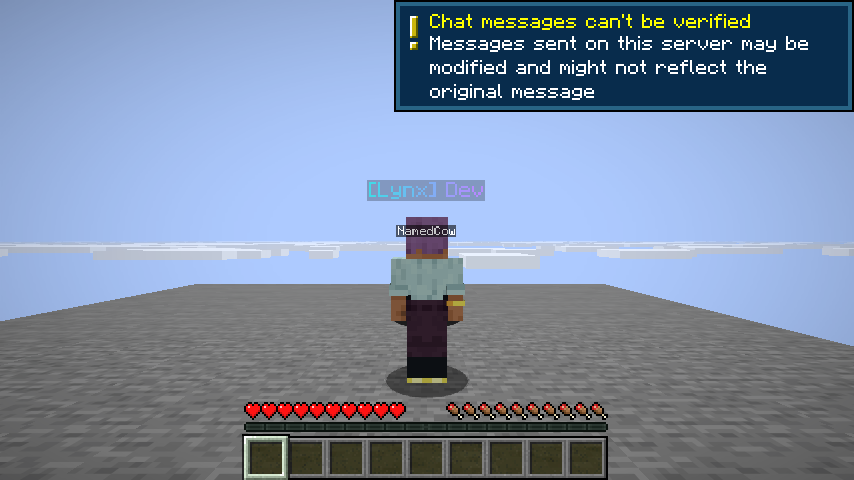
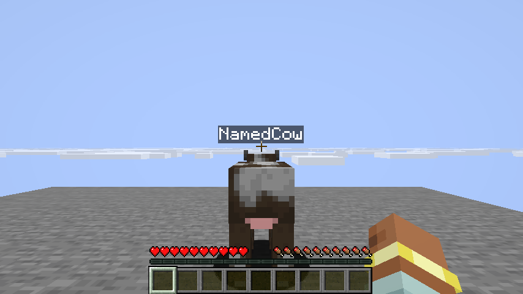
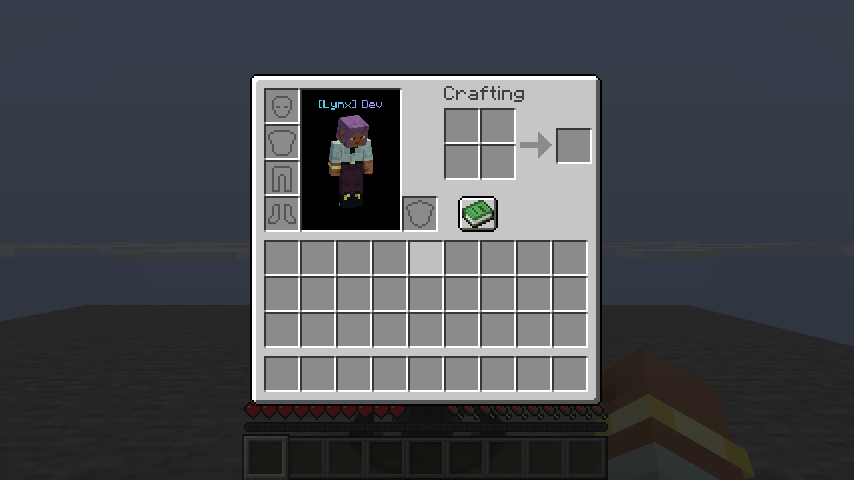
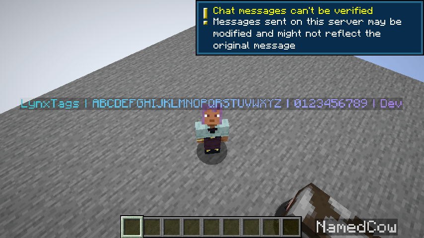

# LynxTags 1.0.0 验证记录 — 2026-10-11

JAR SHA-256：`00353B9158E414B7DAEE5B90A4B431874272DFF9CB2340DA4A85419A7181C5C4`。
环境：MC 26.1.2、NeoForge 26.1.2.115、JDK 25；真实 LWJGL/OpenGL 客户端，NVIDIA RTX 5070 Ti。

## 已通过

- build 成功，JAR 含 Kotlin stdlib，未包含验证代码。
- 真实客户端连接本机独立 LynxTools 服务端，optional 通道协商、payload 编解码、UUID 样式缓存及实际 RGB 文本显示。
- F5 后视角与前视角显示自己的原生名牌。
- 第一人称观察期间自身原生名牌提交数为 0，命名牛的原版标签仍显示。
- 生存 Inventory 人物预览使用原生名牌管线，标签位于头顶，无额外实体/HUD。
- 用户现场确认长串单次青蓝→紫色渐变效果。
- 没有加载 LynxTags 的实际 NeoForge 客户端连接同一服务端并成功执行 /sethome；验证探针是 Java-only，没有注册 LynxTags 通道。
- 两端协议实现去掉包名前缀后完全相同；服务端已通过 reset/渐变/纯文本占位符/Unicode 边界测试。

## 画面

日志：`validation/client-native.log` 中有 LIVE_PROTOCOL_RECEIVED、四个 CLIENT_PHASE_PASS 和 CLIENT_NATIVE_TAGS_PASSED。
`validation/plain-client.log` 有 PLAIN_CLIENT_COMMAND_PASSED，加载 Mod 列表不含 LynxTags。

## 已修正与测试条件

预览适配只应用于 Inventory/创造库存窗口，避免影响其它 GUI 人物模型。
自动视角检查固定每阶段摄像机模式与朝向，防止用户鼠标/键盘操作混入测试。
测试使用开发客户端及本机 offline-mode 隔离服，未验证真实账号认证。长串演示窗口在用户确认后人工结束，该次 runClient 非零退出不是最终自动验收结果；最终自动检查正常退出。

## 未作承诺

未测试全部 GUI 比例、资源包、创造库存页或用户列出的 Freecam/Freelook/Sodium/Iris/Entity Culling 等组合。
没有 Fabric/Bukkit/Paper 或其它 Minecraft 版本实现；第一人称不显示自身 Tag，没有 HUD 替代方案。
基础 Gradle 开发运行 classpath 含编译依赖，客户端代码与图形路径已实测，交付 JAR 的打包内容另行检查；不把这些声明成所有发行环境均已验证。
